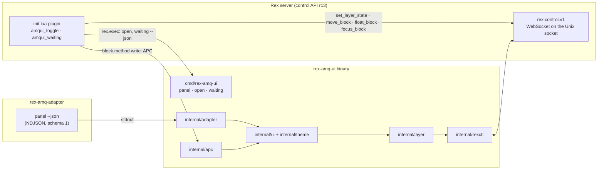

# rex-amq-ui design

rex-amq-ui shows one Rex session's crew to the human in a floating layer of that session. This document covers how its parts fit together, what it will not do, and the Rex behaviour it relies on. The README covers installing and using it.

## Boundaries

The adapter (`rex-amq-adapter`) is the single source of truth for agents, mail, and session views. It owns every file under `~/.local/state/rex-amq-adapter/`, and rex-amq-ui reads none of them. It reads only the NDJSON that `rex-amq-adapter panel --json` writes to stdout. It acts only on its own floating layer and on the human's focus, through Rex's control API.

What rex-amq-ui never does:

- It never sends, reads, or marks AMQ mail. It leaves no read receipts and never moves a message out of `inbox/new`. The Mail tab shows envelopes and only the excerpts that the adapter's view already authorises.
- It never starts, wakes, adopts, or retires an agent.
- It never changes a repository's working tree or Git state.

The adapter enforces the other side of this boundary. `panel --json` refuses an agent's pane, an agent's process tree, and `ME_UNATTENDED=1`, so only a human's terminal (the panel's own block, or the plugin's command run by the Rex server) can read it.

## Parts

| Package | Owns |
|---|---|
| `internal/adapter` | Finding the adapter binary (`REX_AMQ_ADAPTER_BIN`, then Homebrew, then `PATH`). Running `panel --json`, and restarting it with backoff (250 ms doubling to 10 s) when it ends, fails, writes a line that does not decode, or skips a sequence number. Decoding frames as a tolerant reader: unknown fields are ignored, and an unknown frame type or entity decodes as `Unknown`. Folding frames into `State`, an immutable projection that a snapshot replaces. |
| `internal/rexctl` | A client of `rex.control.v1`: one WebSocket on the server's Unix socket, with requests, responses, and events. The panel calls Rex in 0.1–3 ms this way, where starting the `rex` CLI for each call would take about 76 ms. `rexctltest` is a fake server that validates every request against the method schemas recorded from the real server (`rexctltest/schemas`). |
| `internal/layer` | The facts about the panel's layer: its label (`rex-amq-ui`), its two sizes (Drawer `[0.64,0.02,0.35,0.96]`, Board `[0.06,0.06,0.88,0.88]`), and the order of the calls that leave it. Creating or restoring the layer (`Open`, used by `open`). From inside the panel: zoom, minimize, jump to a pane or to another session, and follow focus, owner, size, and the layer id (`Panel.Watch`). |
| `internal/apc` | Taking the private `ESC _ amqui;… ESC \` sequences out of the panel's stdin, wherever reads split them. A 32-byte cap bounds a sequence. A lone `ESC` that waits more than 40 ms counts as the Esc key. |
| `internal/ui`, `internal/theme` | The Bubble Tea model: it folds stream updates, layer states, APC commands, and keys into one state, and renders the five tabs. Its only effects are on its own layer and on opening a hand-back for the human to read. `theme` holds the Everforest palette and the palette taken from the terminal's real colours. |
| `cmd/rex-amq-ui` | The three commands: the panel, `open`, and `waiting`. |
| `lua/rex-amq-ui/init.lua` | The Rex plugin: the two actions and their keys. |

The policy lives in Go and the Lua stays plumbing. The plugin never decides who waits or how a layer is created. It asks the binary (`waiting --json`, `open`) and makes only the few Rex calls that a key press needs to be instant: restoring or minimizing an existing layer, and moving it between tabs. It finds the panel by the same rule as `layer.Open`: a floating-layer block labelled `rex-amq-ui`, preferring the active tab's. If that rule changes, change both.

## Data flow

1. **Opening.** `rex-amq-ui open` attaches to the session and looks for the panel. When there is none, it measures a tiled block of the active tab (`com.superlogical.terminal.size`), works out the terminal size the layer's bounds will give, and creates the layer with `session.new_layer` and `options.size`. Without that size the first frame would be 80×24. It then calls `session.disown_block`, so the Rex app sizes the block from then on. The panel's command line is `rex-amq-ui [--adapter-bin P] --session S --focus <pane> [--tab T] [--board]`, run with `shell: "none"`.
2. **Streaming.** The panel runs the adapter and folds its frames. A restart's snapshot resynchronises everything. While the adapter is down, the header shows `◌ Reconnecting` and the last state stays on screen.
3. **Following Rex.** `Panel.Watch` keeps a control connection, reconnects with a fresh `session.attach`, and turns `session_view_changed` (fetching a newer view when the revision goes up) and `block_owner_changed` into a `layer.State`: the pane the human focused outside the panel (`▶`), the block's owner, whether the layer is minimized, and its size. After a move, Watch finds the panel's new layer id in the view on its own. While the control connection is down, the header shows `◌ Rex` and the panel's actions say it is not connected. Without `REX_SERVER` or a session, the panel still shows the stream.
4. **Acting.** `Enter` on a member minimizes the panel first and then calls `session.focus_block`, which also switches tabs. `Enter` on an Epic first calls `client.perform` of `session.select` on the Rex app, and minimizes only if that succeeds. With Remote Control off the app answers `refused`, and the panel stays up with a footer hint.
5. **The plugin.** See the README's toggle table. `amqui_waiting` runs `rex-amq-ui waiting --json`, which takes only the adapter's first snapshot (5 s at most, with no retry, since a key press is waiting on it) and always stops the adapter before it exits.

## Painting and the transparent-cell problem

A Rex floating layer shows the terminal underneath through every cell drawn with the default background. Every cell the panel emits therefore carries an explicit background:

- each span is rendered with a background;
- each line is padded to the full width with the line's background;
- each frame is padded to the full height;
- styles are never nested, because an inner reset would end the outer background;
- Lipgloss helpers that pad with unstyled spaces are never used.

`line` and `canvas` in `internal/ui/paint.go` are the only ways a view emits text. The paint guard (`TestPaintNoHoles` and the other `holes_test.go` tests) scans every cell of the model's frame across fixtures, tabs, key states, and sizes down to 0×0. Its detector has its own negative test with planted holes.

The guard proves the model's frame, not the terminal. Bubble Tea's renderer clears line tails with EL/ECH while the background is set, so those cells stay opaque only if Rex's terminal does BCE (background colour erase). Rex blocks run with `TERM=xterm-256color`, whose terminfo declares `bce`. That fact is located, not observed on screen. The alt-screen clear at startup runs before the first SGR, which may show one transparent frame.

The program forces TrueColor (`colorprofile.TrueColor`), because `NO_COLOR` or a dumb `TERM` would otherwise strip the backgrounds that keep the panel opaque.

**Colours.** Rex drops OSC 10/11 queries from a block that no app owns yet, and a freshly created block is owned by the launcher for a moment. The panel therefore starts in Everforest dark, and asks for the terminal's real foreground and background only once `block_owner_changed` names an owner. It asks again for each new owner until the terminal answers.

## Pause and resume

A minimized layer keeps its process running. Drawing into it would waste work and, for the Graph tab, leave images behind. The panel pauses on APC `pause` (which the plugin sends before minimizing), on its own minimize, and when it sees its layer minimized in the view. While paused it folds frames, writes nothing, and asks for no colours. It resumes on APC `resume`, on its layer going from minimized to normal (an edge, not a level), or on any key, and it draws the current frame at once. `Q` exits the process.

## Graph renderer

*Not on this branch yet: Slice s3 builds it in `internal/graph`, `internal/kitty`, `internal/raster`, and `internal/pixelmouse`. This section follows the spec (§3.5).*

- **Region.** `ui.Model.GraphRegion()` gives the cell rectangle between the replay bar and the legend (`Y=3`, `H=height−6`). The model paints it with the background until the renderer draws there.
- **Pixel size.** Before the Rex app claims a block, Rex's built-in terminal answers `CSI 16 t` with a synthetic 8×16 cell. The renderer therefore reads `cell_width_px` and `cell_height_px` from `block.method size` over the control connection, and reads them again on `SIGWINCH` and `block_owner_changed`.
- **Rendering.** It uses pure Go SDF rasterisation with an OpenType monospace font (`golang.org/x/image/font/opentype`): anti-aliased node badges and quadratic Bézier edges. Edge width grows with the message count. Solid edges are drained mail, highlighted edges are open obligations, and dashed edges are queued, bounced, or dead-lettered mail. It animates at 24–30 fps only while a member is working, a message is in flight, or a replay transition runs. Otherwise, and while paused, it stops at 0 fps.
- **Kitty transport.** Each frame is written to `/tmp/tty-graphics-protocol-rex-amq-ui-<pid>-<seq>.rgba` and sent with `a=T,f=32,t=t,i=<1|2>,p=1,C=1,q=2`. The two image ids alternate: the new frame is placed first, then the old one is deleted (`a=d,d=I,i=<old>,q=2`), so there is no flicker. Rex deletes a `t=t` file once it has read it, and the panel globs away any leftovers on exit. Leaving the tab or pausing sends `a=d,d=A,q=2`.
- **Mouse.** SGR pixel mouse (`?1002h ?1006h ?1016h`) hit-tests nodes, using the real cell height to subtract the header.

## Rex control-protocol notes

These were observed against Rex 0.1.0-preview.18 (API revision 13). Each one is marked with how it was checked.

- **`session.set_layer_state`.** `focus: true` with `normal` raises the layer, focuses its last-focused block, and makes its window active, all in one revision. Minimizing a layer that has focus returns focus to the layer used before it (from the schema notes; reproduced by `integration.sh`).
- **Moving between tabs.** There is no single call that moves a floating layer to another window. `session.move_block` places the panel's block beside a tiled block of the active tab (the anchor must be in a window's layout), and `session.float_block` floats it again at the old layer's bounds. `float_block` does not focus, so `set_layer_state normal, focus` follows it. The old tab is left with no empty floating layer (reproduced).
- **`Q`.** The panel's terminal uses Rex's default `exit.on_completion`, so when the panel exits, Rex closes its block, and the floating layer goes with it. The next toggle opens a new panel; there is never an empty layer to clean up (reproduced).
- **APC delivery.** `block.method write` with `{"data": "\u001b_amqui;tab:mail\u001b\\"}` reaches the panel's stdin. The panel switches tabs, and none of the bytes show on screen (reproduced).
- **Running the binary from Lua.** Rex's Lua raises on `io.popen` and `os.execute`. `rex.exec(argv, opts)` runs a command and returns `{ok, code, stdout, stderr, timed_out}`, or `nil, err` when the command could not start. `rex.call` returns `nil, err` and never raises. A config action has 30 seconds, and the server keeps handling keys while it waits (from the Rex Lua reference). The plugin calls both through `pcall` anyway, and guards each action as a whole.
- **The plugin's environment.** `rex.exec` children inherit the Rex server's environment. On est9's machine that includes `REX_SERVER` and a `PATH` with `/opt/homebrew/bin` and `~/.local/bin`, but not the Go bin directory. The plugin therefore passes `--session` explicitly and resolves `rex-amq-ui` through the login shell. This was read from the running server's environment (located). `integration.sh` runs the plugin through `rex do`, so it does not cover the server's own environment.
- **No toast.** Neither Rex's Lua nor the Mac client actions can show a message, so failures go to `rex.log` and to the action's result.
