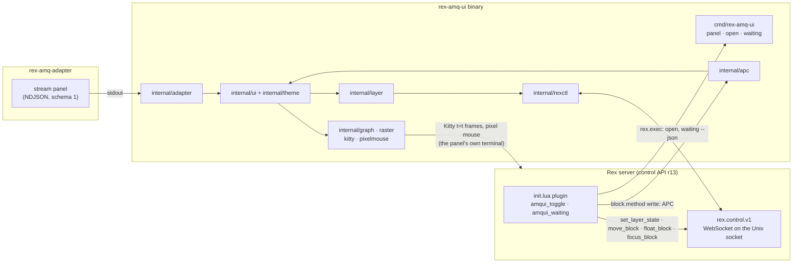

# rex-amq-ui design

rex-amq-ui shows one Rex session's crew to the human in a floating layer of that session. This document covers how its parts fit together, what it will not do, and the Rex behaviour it relies on. The README covers installing and using it.

## Boundaries

The adapter (`rex-amq-adapter`) is the single source of truth for agents, mail, and session views. It owns every file under `~/.local/state/rex-amq-adapter/`, and rex-amq-ui reads none of them. It reads only the NDJSON that `rex-amq-adapter stream panel` writes to stdout. It acts only on its own floating layer and on the human's focus, through Rex's control API. It writes four kinds of file of its own, none of them adapter state: the Graph tab's frame files, `/tmp/tty-graphics-protocol-rex-amq-ui-<pid>-<seq>.rgba`, read-only (`0444`) copies that `o` opens in `<user cache dir>/rex-amq-ui/` (`os.UserCacheDir()`, which is `~/Library/Caches` on macOS) — `<session>-hand-back-<seq>.md` for a hand-back and `<session>-mail-<safeID>.md` for a selected message's envelope metadata and authorized session-view excerpt (replacing any earlier copy of the same file) — and `<user cache dir>/rex-amq-ui/state.json`, which atomically persists the last `Drawer` or `Board` size chosen via `z` or APC `zoom`.

What rex-amq-ui never does:

- It never sends, reads, or marks AMQ mail. It leaves no read receipts and never moves a message out of `inbox/new`. The Mail tab shows envelopes and only the excerpts that the adapter's view already authorises.
- It never starts, wakes, adopts, or retires an agent.
- It never changes a repository's working tree or Git state.

The adapter enforces the other side of this boundary. `stream panel` refuses a harness session's environment (`CLAUDE_CODE_SESSION_ID`, `CODEX_THREAD_ID`, `PI_SESSION_ID`, `ANTIGRAVITY_CONVERSATION_ID`), an agent's pane, an agent's process tree, and `ME_UNATTENDED=1`, so only a human's terminal (the panel's own block, or the plugin's command run by the Rex server) can read it. Its refusal is a `guard_denied` failure envelope with `retryable:false` (see Data flow, Streaming).

## Parts

| Package | Owns |
|---|---|
| `internal/adapter` | Finding the adapter binary (`REX_AMQ_ADAPTER_BIN`, then Homebrew, then `PATH`). Running `stream panel`, and restarting it with backoff (250 ms doubling to 10 s) when it ends, fails, writes a line that does not decode, or skips a sequence number. Reading the v:2 failure envelope (`{"ok":false,"v":2,"error":{…}}`) a run may write before its snapshot as an `EnvelopeError` (`envelope.go`), and ending the stream without a restart (`Refused`) when the envelope says `retryable:false`. Decoding frames as a tolerant reader: unknown fields are ignored, and an unknown frame type or entity decodes as `Unknown`. Folding frames into `State`, an immutable projection that a snapshot replaces. |
| `internal/rexctl` | A client of `rex.control.v1`: one WebSocket on the server's Unix socket, with requests, responses, and events. The panel calls Rex in 0.1–3 ms this way, where starting the `rex` CLI for each call would take about 76 ms. `rexctltest` is a fake server that validates every request against the method schemas recorded from the real server (`rexctltest/schemas`). |
| `internal/layer` | The facts about the panel's layer: its label (`rex-amq-ui`), its two sizes (Drawer `[0.57,0.02,0.42,0.96]`, Board `[0.06,0.06,0.88,0.88]`), persisting the last chosen size in `<user cache dir>/rex-amq-ui/state.json` (`LoadSize`, `SaveSize`), and the order of the calls that leave it. Creating or restoring the layer (`Open`, used by `open`). From inside the panel: zoom, minimize, jump to a pane (`Jump`, or cross-session `JumpToSession` via a short-lived attached client), switch to another session (`SwitchTo`), and follow focus, owner, size, and the layer id (`Panel.Watch`). |
| `internal/apc` | Taking the private `ESC _ amqui;… ESC \` sequences out of the panel's stdin, wherever reads split them. A 32-byte payload cap (the part after `ESC _ amqui;`) bounds a sequence. A lone `ESC` that waits more than 40 ms counts as the Esc key. |
| `internal/ui`, `internal/theme` | The Bubble Tea model: it folds generation-tagged stream updates (`StreamUpdate`), layer states, APC commands, keys (including direct tab keys `Alt+1..5`/`F1..F5`/`[`/`]`/`H`/`L`), and SGR mouse events (`mouse.go`: wheel, tab-bar click, row click/double-click) into one state, renders the five tabs (with uncapped paragraph wrapping and line-level scrolling for tall cards/excerpts, responsive Drawer widths/compact model badges, Mail participant cycling/search, and the zero-temp-file Unicode/TUI Graph topology in `graph_tui.go`), and supports in-panel Hub Epic drill-down (`drillDown` / `popBack`, header breadcrumb, and Graph reset). Its only effects are on its own layer, on switching the subscribed session stream, on opening a read-only hand-back or authorized mail export for the human to read, and on the Graph tab's Kitty image (`graph.go`). `theme` holds the Everforest palette and the palette taken from the terminal's real colours. |
| `internal/graph` | The Graph tab's Kitty picture: the replay cursor's view of the mail, the selection, pulses, and the animation clock (`Model`); nodes and edges placed at a pixel size (`Scene`); drawing a scene (`Paint`). |
| `internal/raster` | Anti-aliased shapes and Go Mono text drawn into an opaque RGBA canvas in pure Go, sized from the terminal's cell size. `rastertest` compares a canvas with a reference PNG. |
| `internal/kitty` | Sending frames with the Kitty graphics protocol (`Transport`, including proactive own-PID stale frame cleanup in `Clear`) and pacing them at up to 15 fps (`MaxFPS`) while something moves (`Scheduler`). |
| `internal/pixelmouse` | The escape sequences that turn SGR pixel mouse reports on and off, and the hit test from a pointer's pixel to a node. Bubble Tea parses the reports. |
| `cmd/rex-amq-ui` | The three commands: the panel, `open`, and `waiting`. The panel's dynamic session stream supervisor (`streamManager`), its terminal writer shared under one lock by the renderer and the Graph tab, and its exit path, which tears the Graph image down. |
| `lua/rex-amq-ui/init.lua` | The Rex plugin: the two actions and their keys. |

The policy lives in Go and the Lua stays plumbing. The plugin never decides who waits or how a layer is created. It asks the binary (`waiting --json`, `open`) and makes only the few Rex calls that a key press needs to be instant: restoring or minimizing an existing layer, and moving it between tabs. It finds the panel by the same rule as `layer.Open`: a floating-layer block labelled `rex-amq-ui`, preferring the active tab's. If that rule changes, change both. The label is reserved: neither side can tell a block of the user's that carries the same label from the panel. The plugin adds one fallback that `open` lacks: a block labelled `rex-amq-ui` in a window's tiled layout. A cross-tab move that broke off between `move_block` and `float_block` leaves the panel there, and the next toggle floats it again instead of opening a second panel.

The plugin undoes a transition it leaves half done. If Rex refuses to minimize a layer after the plugin paused the panel, the plugin resumes the panel, because a paused panel on a visible layer would look frozen and never see a minimized-to-normal edge. With one waiter, it focuses the pane only after it has read the view and minimized the panel; if either fails, it focuses nothing, which is the order the panel's own `Enter` uses.

## Data flow

1. **Opening.** `rex-amq-ui open` attaches to the session and looks for the panel. When there is none, it measures a tiled block of the active tab (`com.superlogical.terminal.size`), works out the terminal size the layer's bounds will give, and creates the layer with `session.new_layer` and `options.size`. Without that size the first frame would be 80×24. It then calls `session.disown_block`, so the Rex app sizes the block from then on. The panel's command line is `rex-amq-ui [--adapter-bin P] --session S --focus <pane> [--tab T] [--board]`, run with `shell: "none"`.
2. **Streaming.** The panel runs the adapter through `streamManager` and folds its frames. A restart's snapshot resynchronises everything. When the human drills into a linked Epic from a Hub session's Epics tab (or pops back on `Esc`/`Backspace`/`q`), `streamManager` cancels the active child `adapter.Stream`, waits for its process to exit, and starts a new stream for `--session <target>`. Every delivered frame and status update carries its subscription generation (`ui.StreamUpdate`) so late updates already queued from a cancelled stream are dropped before they can corrupt the newly selected session. Before its snapshot, a run may instead write one v:2 failure envelope (`{"ok":false,"v":2,"error":{…}}`) and exit non-zero; the stream reads that line as an `EnvelopeError` (code, message, next action) rather than as a frame. A refusal marked `retryable:false` (a usage error, a guard denial) ends the stream: the header shows `✕ Refused` and no other run starts, since the same arguments and environment would be refused again. A retryable one is restarted with backoff like any other run that ended. After the snapshot, every line is a `schema: 1` frame, and an envelope there is a frame that does not decode. While the adapter is down, the header shows `◌ Reconnecting` and the last state stays on screen.
3. **Following Rex.** `Panel.Watch` keeps a control connection, reconnects with a fresh `session.attach`, and turns `session_view_changed` (fetching a newer view when the revision goes up) and `block_owner_changed` into a `layer.State`: the pane the human focused outside the panel (`▶`), the block's owner, whether the layer is minimized, and its size. After a move, Watch finds the panel's new layer id in the view on its own. While the control connection is down, the header shows `◌ Rex` and the panel's actions say it is not connected. Without `REX_SERVER` or a session, the panel still shows the stream.
4. **Acting.** `Enter` on a member in the panel's own session minimizes the panel first and then calls `session.focus_block`, which also switches tabs. On Epics, `Enter` drills into the selected Epic in-place (`← <hub> › <epic>`) without leaving the Hub window, `o` opens the selected Epic's hand-back directly, and `s` (on Epics or inside a drilled-down Epic) calls `client.perform` of `session.select` on the Rex app and minimizes only if that succeeds. Inside a drilled-down Epic, `Enter` on a member or alert uses `JumpToSession`: it selects the Epic session on the Rex app, dials a short-lived control client attached to the Epic session to call `session.focus_block` (keeping the panel's own Watch connection attached only to the Hub session), and then minimizes the Hub panel. With Remote Control off the app answers `refused`, and the panel stays up with a footer hint.
5. **The plugin.** See the README's toggle table. `amqui_waiting` runs `rex-amq-ui waiting --json`, which takes only the adapter's first snapshot (5 s at most, with no retry, since a key press is waiting on it) and always stops the adapter before it exits.

## Painting and the transparent-cell problem

A Rex floating layer shows the terminal underneath through every cell drawn with the default background. Every cell the panel emits therefore carries an explicit background:

- each span is rendered with a background;
- each line is padded to the full width with the line's background;
- each frame is padded to the full height;
- styles are never nested, because an inner reset would end the outer background;
- Lipgloss helpers that pad with unstyled spaces are never used.

`line` and `canvas` in `internal/ui/paint.go` are the only ways a view emits text. The paint guard (`TestPaintNoHoles` and the other `holes_test.go` tests) scans every cell of the model's frame across fixtures, tabs, key states, and sizes down to 0×0. Its detector has its own negative test with planted holes.

The guard proves the model's frame, not the terminal. Bubble Tea's renderer clears line tails with EL/ECH while the background is set, so those cells stay opaque only if Rex's terminal does BCE (background colour erase). Rex blocks run with `TERM=xterm-256color`, whose terminfo declares `bce`. That fact is located, not observed on screen. The alt-screen clear at startup runs before the first SGR, which may show one transparent frame.

The program forces TrueColor (`colorprofile.TrueColor`), because `NO_COLOR` or a dumb `TERM` would otherwise strip the backgrounds that keep the panel opaque.

**Colours.** Rex drops OSC 10/11 queries from a block that no app owns yet, and a freshly created block is owned by the launcher for a moment. The panel therefore starts in Everforest dark, and asks for the terminal's real foreground and background only once `block_owner_changed` names an owner. It asks again for each new owner until the terminal answers.

## Pause and resume

A minimized layer keeps its process running. Drawing into it would waste work, and on the Graph tab would leave an image behind. The panel pauses on APC `pause` (which the plugin sends before minimizing), on its own minimize, and when it sees its layer minimized in the view. `pause()` captures both the rendered frame (`frozen`) and the active Bubble Tea `MouseMode` (`frozenMouse`), so while paused `View()` stays identical and writes nothing while frames still fold, and asks for no colours. It resumes on APC `resume`, on its layer going from minimized to normal (an edge, not a level), or on any key, and it draws the current frame at once. `Q` exits the process.

Bubble Tea's renderer repaints on every resize, so the program's message filter (`ui.Filter`) holds a resize that arrives while the panel is paused and hands the model the size instead. The model passes the size on to the renderer when it resumes. Pausing also counts as leaving the Graph tab: the image is deleted, pixel mouse reports are turned off, and the frame loop stops.

## Graph renderer

The Graph tab renders into the cell rectangle `ui.Model.GraphRegion()` gives (`X=1, Y=4`, `W=width−2, H=height−8`, inside the 1-cell border, between the replay bar and the legend). It supports two modes (`t` toggles between them, and the replay bar displays a `TUI` or `Kitty` capsule):

- **Unicode/TUI topology (`internal/ui/graph_tui.go`).** Active whenever `t` toggles TUI mode on, `Deps.Graphics` is nil, cell pixel metrics are unavailable, or Kitty delivery hits `kitty.ErrBacklog`. It writes zero `/tmp` files, renders every live member (and retired members unless `hideRetired` is set) with no `MaxActive = 6` cap and no `+N` collapsing, shows directed Unicode arrows matching the legend palette (`──▶` drained, `━━▶` open obligation, `┄┄▶` queued/alert, `◆` on the active replay/latest message edge), and supports `j`/`k`/mouse wheel scrolling, click selection (syncing Members), and double-click/`Enter` pane focus. Because it renders into a fixed `(c.w, GraphRegion().H)` sub-canvas, every cell stays opaque under `TestPaintNoHoles`.
- **Kitty graphics image (`internal/ui/graph.go`).** Active only when `!graphTUI && gfx != nil && cell.Valid() && !stalled`. The text frame paints `GraphRegion()` with the background, and the image is placed over it. `graphTab` ties the parts together and runs only inside `Update`, so one goroutine changes it.

- **Cell size.** Before the Rex app claims a block, Rex's built-in terminal answers `CSI 16 t` with a synthetic 8×16 cell. The panel therefore asks Rex for its block's `cell_width_px` and `cell_height_px` (`layer.Panel.CellSize`, over the control connection). It asks when the tab starts showing, on a resize, when the block's owner changes, and when the control connection comes back. It never asks again just because the last answer failed, so outside Rex it does not loop. Without a valid cell size it draws no Kitty image and renders the TUI topology automatically.
- **Drawing.** `graph.Model` takes each new `adapter.State`. In Kitty image mode it places the lead at the top of an ellipse and the others clockwise, with up to 6 live members and a `+N` node for the rest, plus up to 2 retired members while they are shown. Edges are quadratic curves with one lane per direction, routed around other nodes, and their width grows with the message count. Styles: drained is a solid line, queued and bounced or dead-lettered mail are dashed, and an open obligation is a solid line over a translucent glow. Colours come from the panel's palette, so the image matches the cells around it. `raster` draws with signed distance fields and Go Mono text, compiled into the binary. A 2254×1372 px frame takes about 7 ms to draw and send, file included. `testdata/graph/*.png` and `testdata/raster/*.png` are the reference frames at 9×22 and 23×49 px cells; the TUI topology and text legend live in `testdata/golden/graph_*.golden`.
- **Pacing.** A frame is due when the picture changed (new state, a replay step, a selection, a new cell size or colour) or moves on its own (a working member breathes; a new message's pulse runs for 1.2 s). `kitty.Scheduler` runs a frame loop capped at `<= 15` fps (`kitty.MaxFPS`) only while one is due, and draws a last frame when the motion stops. An idle graph sends nothing. Each tick fires once, and a tick from a stopped loop changes nothing. A new showing, and a resize, waits 50 ms before its first frame. The wait is a heuristic: it is meant to let the renderer's erase-and-repaint after a resize or a resume land first, in case that repaint deletes images. Whether it does on Rex is unverified (see below).
- **Kitty transport.** `kitty.Transport.Show` writes the frame to `/tmp/tty-graphics-protocol-rex-amq-ui-<pid>-<seq>.rgba` and sends, in one write, `a=T,f=32,t=t,i=<1|2>,p=1,C=1,q=2` at the region's top-left cell (cursor saved and restored around it), then `a=d,d=I,i=<old>,q=2`. The two image ids alternate, and the command that places the new image comes before the one that deletes the old, which tests prove of the bytes. That the order avoids a visible blank between frames on Rex is the intent, not yet observed. Leaving the tab, pausing, minimizing, toggling TUI mode, or falling back on `ErrBacklog` calls `Clear`, which sends `a=d,d=A,q=2` and proactively removes this PID's stale `.rgba` files without touching other PIDs' files. At most 3 frame files may wait unread; past that `Show` refuses with `ErrBacklog`, and `graphTab` immediately clears the frozen image, removes the stale frame files, stops the animation tick loop, and switches to live TUI topology (`t` clears the fallback flag to retry Kitty).
- **Write order.** The renderer and the Graph tab write to the terminal through one locked writer (`lockOutput` in `cmd/rex-amq-ui`). Every graphics command is written synchronously from `Update`, so a teardown cannot be overtaken by the frame before it, or land after the next showing's frame. What the tab believes is on screen changes only after a write succeeds. A write cut off part way counts as possibly on screen, so the teardown stays owed and is retried on the next `Update`, and the next write starts with CAN ST to get the terminal's parser out of a half-sent sequence.
- **Mouse.** Outside Kitty image mode, `View()` sets `tea.MouseModeCellMotion` so Bubble Tea arms SGR cell mouse (`?1002h ?1006h`) for wheel scrolling, tab-bar clicks, and row clicks/double-clicks across all tabs. While Kitty Graph is settling or drawing, `View()` sets `tea.MouseModeNone` so Bubble Tea disables cell mouse during `settleDelay` and never clobbers `pixelmouse.Enable` (`?1002h ?1006h ?1016h`); leaving Kitty Graph runs `pixelmouse.Disable` and transitions `View().MouseMode` back to `MouseModeCellMotion` to immediately re-arm SGR cell mouse. While pixel mouse is active, clicks inside `GraphRegion()` go to `pixelmouse.HitTest` and clicks outside it (such as the tab bar) divide pixel `(X, Y)` by `(CellW, CellH)` to hit-test cells.
- **Exit.** `runPanel` ends through `endPanel`, which calls `Model.CloseGraphics` after Bubble Tea's own terminal reset: it deletes the image, turns pixel mouse reports off, and removes this process's unread frame files. A panic still runs it and stays an error; only the caller's cancellation counts as a normal end.

**Not seen on Rex yet.** The Kitty Graph path is tested headless, against a fake Kitty terminal that keeps screen state. These Rex behaviours Kitty image mode relies on have not been observed:

- whether text written over the region, or an erase, deletes the image (the 50 ms settle exists for this, and no test can see it);
- whether Rex deletes a `t=t` file after reading it, as the Kitty protocol says; if it does not, the 3-frame budget now immediately falls back to live TUI topology and removes the stale frame files rather than stalling;
- whether the exit clear, written after the program leaves the alternate screen, reaches images placed in it;
- whether mouse pixels and `cell_*_px` use the same unit (device pixels on Retina);
- whether SGR 1016 coordinates are 1-based, as Bubble Tea assumes.

**Known risks.**

- A terminal that stops reading the panel's output blocks `Update` on its next graphics write, and the panel stalls until the terminal drains. Rex reads every block's pty continuously, minimized layers included. A writer goroutine with a queue would avoid the stall at the cost of the write-order guarantee above.
- While something animates in Kitty image mode, a Retina Board writes frame files to `/tmp` at up to 15 fps (halved from 30 fps; TUI mode and idle graphs write zero `/tmp` files).
- `TestGraphTabProgramPanicCleansUp` skips under `-race`: Bubble Tea v2.1.1 closes its cancel reader on a panic without waiting for its read loop, which the race detector flags about once in ten runs. `TestGraphTabEndPanelKeepsPanic` covers the panel's own part under `-race`.

## Rex control-protocol notes

These were observed against Rex 0.1.0-preview.18 (API revision 13). Each one is marked with how it was checked.

- **`session.set_layer_state`.** `focus: true` with `normal` raises the layer, focuses its last-focused block, and makes its window active, all in one revision. Minimizing a layer that has focus returns focus to the layer used before it (from the schema notes; reproduced by `integration.sh`).
- **Moving between tabs.** There is no single call that moves a floating layer to another window. `session.move_block` places the panel's block beside a tiled block of the active tab (the anchor must be in a window's layout), and `session.float_block` floats it again at the old layer's bounds. `float_block` does not focus, so `set_layer_state normal, focus` follows it. The old tab is left with no empty floating layer (reproduced).
- **`Q`.** The panel's terminal uses Rex's default `exit.on_completion`, so when the panel exits, Rex closes its block, and the floating layer goes with it. The next toggle opens a new panel; there is never an empty layer to clean up (reproduced).
- **APC delivery.** `block.method write` with `{"data": "\u001b_amqui;tab:mail\u001b\\"}` reaches the panel's stdin. The panel switches tabs, and none of the bytes show on screen (reproduced).
- **Running the binary from Lua.** Rex's Lua raises on `io.popen` and `os.execute`. `rex.exec(argv, opts)` runs a command and returns `{ok, code, stdout, stderr, timed_out}`, or `nil, err` when the command could not start. `rex.call` returns `nil, err` and never raises. A config action has 30 seconds, and the server keeps handling keys while it waits (from the Rex Lua reference). The plugin calls both through `pcall` anyway, and guards each action as a whole.
- **The plugin's environment.** `rex.exec` children inherit the Rex server's environment. On est9's machine that includes `REX_SERVER` and a `PATH` with `/opt/homebrew/bin` and `~/.local/bin`, but not the Go bin directory. The plugin therefore passes `--session` explicitly and resolves `rex-amq-ui` through the login shell. This was read from the running server's environment (located). `integration.sh` runs the plugin through `rex do`, so it does not cover the server's own environment.
- **No toast.** Neither Rex's Lua nor the Mac client actions can show a message, so failures go to `rex.log` and to the action's result.
